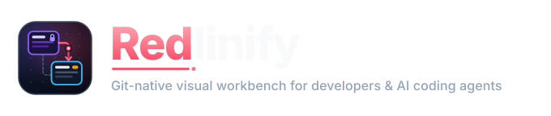
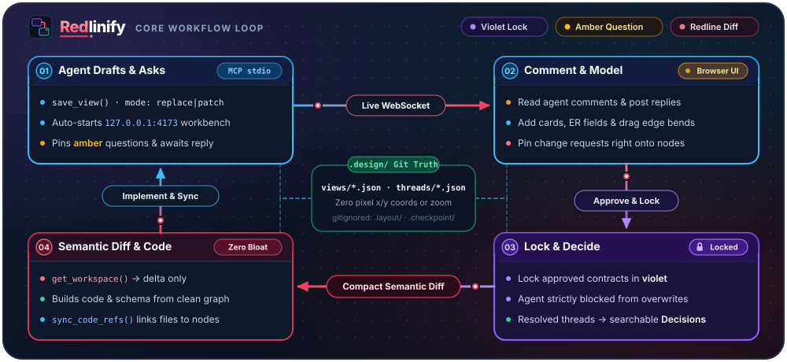
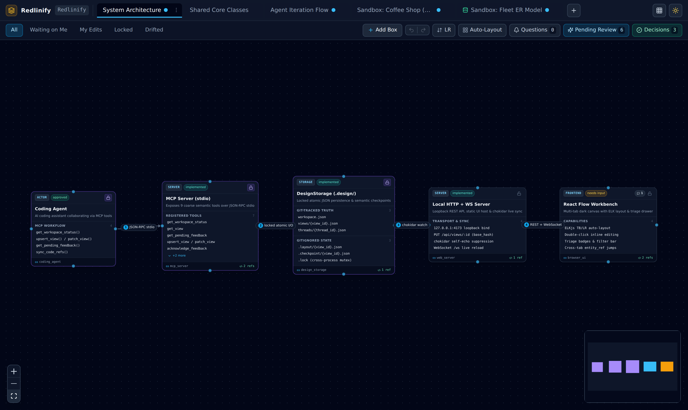
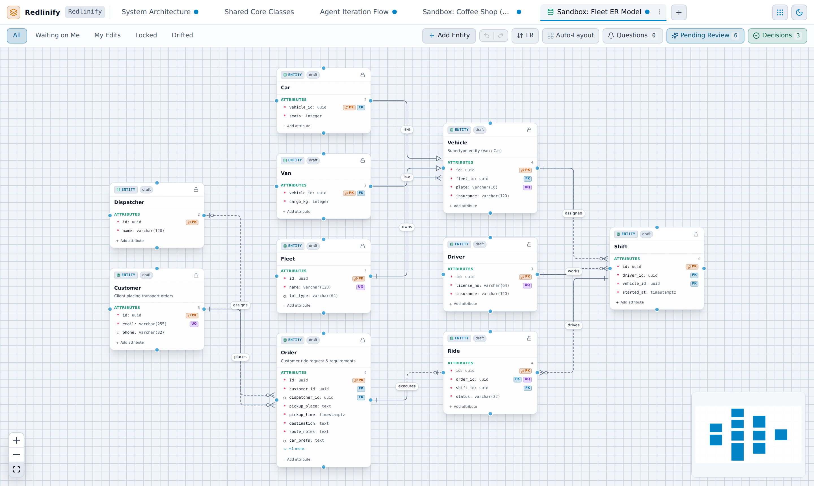
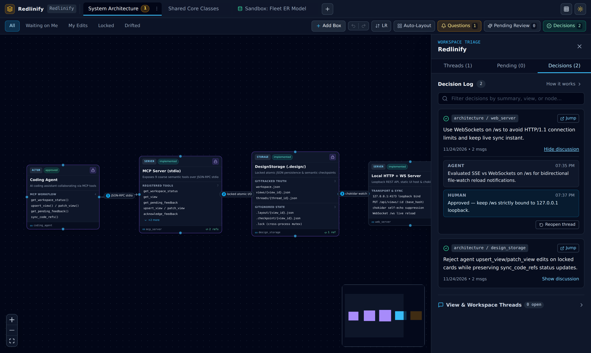

<p align="center">
  <picture>
    <source media="(prefers-color-scheme: dark)" srcset="docs/media/logo-dark.svg" />
    <source media="(prefers-color-scheme: light)" srcset="docs/media/logo-light.svg" />
    
  </picture>
</p>

<p align="center">
  <strong>Stop negotiating software architecture and DB schemas in linear chat threads.</strong>
</p>

<p align="center">
  <a href="https://github.com/wltwror/Redlinify/actions/workflows/ci.yml"></a>
  <a href="LICENSE"></a>
  <a href="#zero-friction-setup">= 22" /></a>
  <a href="#development--architecture"></a>
  <a href="#mcp-tool-reference-6-tools"></a>
</p>

<p align="center">
  <a href="#interactive-demo">Demo</a> ·
  <a href="#how-it-works">How It Works</a> ·
  <a href="#why-redlinify">Features</a> ·
  <a href="#visual-tour">Screenshots</a> ·
  <a href="#zero-friction-setup">Setup</a> ·
  <a href="#mcp-tool-reference-6-tools">MCP Tools</a>
</p>

<p align="center">
  Redlinify gives you and your AI coding agent a shared, Git-tracked visual workbench directly inside your repo. Agents draft diagrams over MCP and launch the local browser UI automatically; you edit nodes, reply to questions, bend lines, and lock approved specs—then send back a compact <strong>semantic diff</strong> with zero pixel noise.
</p>

---

## Interactive Demo

<!-- Tip: For GitHub's native HD HTML5 video player, drag docs/media/demo.mp4 into the GitHub web editor on GitHub.com and replace the  tag below with the generated https://github.com/user-attachments/assets/... URL -->
<p align="center">
  
</p>

<p align="center">
  <sub>Animated logo intro · Read &amp; reply to agent comments · Pin change requests &amp; lock in violet · Model &amp; bend ER lines (<code>Ctrl+Z</code>) · Compact semantic diff &amp; Decision Log · <a href="docs/media/demo.mp4">Watch 47s HD MP4</a></sub>
</p>

---

## How It Works

Redlinify runs a closed, Git-native collaboration loop between your coding agent and your browser—centered around a zero-coordinate `.design/` folder in your repository:

<p align="center">
  <picture>
    <source media="(prefers-color-scheme: dark)" srcset="docs/media/workflow-dark.svg" />
    <source media="(prefers-color-scheme: light)" srcset="docs/media/workflow-light.svg" />
     Comment & Model -> Lock & Decide -> Compact Semantic Diff & Code" width="920" />
  </picture>
</p>

| Stage | Where | What Happens |
| :--- | :--- | :--- |
| **01 · Agent Drafts & Asks** | `MCP stdio` | Agent calls `save_view()`, auto-starts `127.0.0.1:4173`, and pins **amber** questions for your input. |
| **02 · Comment & Model** | `Browser UI` | Over live WebSockets, you read & reply to agent threads, right-click to add nodes or ER fields, connect edges, and drag bends. |
| **03 · Lock & Decide** | `Violet Guard` | Lock approved cards and contracts in **violet** so the agent cannot overwrite them; resolved threads graduate to **Decisions**. |
| **04 · Semantic Diff & Code** | `Zero Bloat` | `get_workspace()` returns only structural changes (`+node`, `~field`, replies), and `sync_code_refs()` links built files back to nodes. |

---

## Why Redlinify?

<table>
  <tr>
    <td width="50%" valign="top">
      <strong>🔄 Two-Way Structured Editing</strong><br />
      Unlike read-only Mermaid or brittle ASCII boxes, you and your agent edit the exact same clean <code>.design/views/*.json</code> graph.
    </td>
    <td width="50%" valign="top">
      <strong>🔒 Violet Locks Protect Approved Specs</strong><br />
      Lock finalized nodes and edges so agents cannot overwrite them—while still letting <code>sync_code_refs()</code> update code links and build status.
    </td>
  </tr>
  <tr>
    <td width="50%" valign="top">
      <strong>⚡ Token-Efficient Semantic Diffs</strong><br />
      Pixel <code>x/y</code> coordinates, edge bends, and zoom stay gitignored in <code>.design/.layout/</code>. Agents read only structural deltas against checkpoints.
    </td>
    <td width="50%" valign="top">
      <strong>🗄️ System Architecture &amp; Crow's Foot ER</strong><br />
      Switch seamlessly between module diagrams and relational ER models (<code>PK</code>, <code>FK</code>, <code>UQ</code>, mandatory <code>*</code> vs optional <code>○</code>, and <code>is-a</code> subtypes).
    </td>
  </tr>
  <tr>
    <td width="50%" valign="top">
      <strong>💬 Comments &amp; Searchable Decision Log</strong><br />
      Discuss edge cases right on boxes or lines; resolved discussions become an anchored, searchable ADR log inside <strong>Decisions</strong>.
    </td>
    <td width="50%" valign="top">
      <strong>🏠 Local-First &amp; Zero Telemetry</strong><br />
      Everything lives as readable JSON in your Git repo, and the UI binds strictly to loopback (<code>127.0.0.1</code>) with zero cloud dependencies.
    </td>
  </tr>
</table>

---

## Visual Tour

### System Architecture — Dark Mode

Approved contracts stay **locked in violet** with live `code_refs` badges attached, while nodes awaiting human feedback highlight in **amber** both on the canvas and in the MiniMap.

<p align="center">
  
</p>

### Crow's Foot ER Modeling — Light Mode & Drafting Grid

Model entities with `PK` / `FK` / `UQ` badges, mandatory (`*`) vs nullable (`○`) columns, Crow's foot cardinalities, and subtype forks—complete with instant **Dark/Light** and **Dots/Grid** toggles.

<p align="center">
  
</p>

### Searchable Decision Log & Anchored Threads

Resolved architectural threads move cleanly into the searchable **Decision Log**, preserving full multi-turn context alongside every node and edge across `draft → needs_input → approved → implemented | drifted`.

<p align="center">
  
</p>

---

## Zero-Friction Setup

Requires **Node.js >= 22.0.0**.

```bash
git clone https://github.com/wltwror/Redlinify.git
cd Redlinify && npm install && npm run build && npm test
npm link -w @redlinify/server
```

Add Redlinify once to **Claude Code**, **Cursor**, **OpenCode**, or any MCP client—no manual `init` or UI terminal required:

```json
{
  "mcpServers": {
    "redlinify": {
      "command": "redlinify",
      "args": ["mcp"]
    }
  }
}
```

* Built-in MCP instructions teach your agent how to draft views, pin questions, respect violet locks, and resolve decisions automatically.
* On the first diagram write in any Git repo, Redlinify initializes `.design/` and spawns the detached loopback UI daemon (`127.0.0.1:4173`), returning `ui_url`.

<details>
<summary>Alternative MCP setup (without <code>npm link</code>) &amp; manual CLI commands</summary>

```json
{
  "mcpServers": {
    "redlinify": {
      "command": "node",
      "args": ["/path/to/Redlinify/packages/server/dist/cli.js", "mcp"]
    }
  }
}
```

```bash
redlinify mcp --open --dir /path/to/repo   # Start MCP + auto-open browser immediately
redlinify mcp --no-ui --dir /path/to/repo  # Headless MCP without auto-starting the UI
redlinify ui --open --dir /path/to/repo    # Launch workbench UI standalone
redlinify stop --dir /path/to/repo         # Stop the detached UI daemon
redlinify init --dir /path/to/repo         # Pre-initialize .design/ explicitly
```

</details>

---

## Repository Structure (`.design/`)

```text
.design/
├── workspace.json              # Git-tracked: tab order, metadata, pending view_requests
├── views/*.json                # Git-tracked: semantic graphs (zero pixel coordinates)
├── threads/*.json              # Git-tracked: anchored discussions & resolved Decisions
├── .layout/                    # Gitignored: node positions, edge bend points, zoom
├── .checkpoint/                # Gitignored: last agent-authored semantic snapshot
└── .ui-server.json             # Gitignored: active detached UI server PID & port
```

---

## MCP Tool Reference (6 Tools)

| Tool | Role | Purpose |
| :--- | :--- | :--- |
| `get_workspace` | `Read` | Return tabs (`view_hash`, triage/drifted counts), `entity_ref` slugs, `view_requests`, pending semantic diffs, open threads, and `ui_url` (or launch browser with `open_browser: true`). |
| `get_view` | `Read` | Read a semantic `DesignView` (zero coordinates), its `view_hash`, open threads, and optional 1-line Decision summaries. |
| `get_decisions` | `Read` | Query resolved Decision (ADR) transcripts—or `open`/`all` threads—by `view_id`, `target_id`, `entity_ref`, or text `query`. |
| `save_view` | `Write` | Create/replace (`mode="replace"`), incrementally upsert/remove nodes & edges (`mode="patch"`), or accept human edits (`mode="acknowledge"`) with `base_hash` concurrency, violet lock guards, and auto-UI launch. |
| `post_thread` | `Write` | Open an anchored thread (`question`, `change_request`, `decision`, `drift_alert`), reply, reopen, or resolve with a 1-line ADR `resolution_summary`. |
| `sync_code_refs` | `Write` | Link source `code_refs` (`path:symbol`) and update `implemented` / `drifted` status on nodes (including locked ones) without clobbering unrelated edits. |

---

<details id="canvas--keyboard-controls">
<summary><strong>Canvas &amp; Keyboard Controls</strong></summary>

<br />

| Action | Shortcut / Gesture |
| :--- | :--- |
| Select element & open inspector | Click a box/entity or relationship line |
| Multi-select boxes | `Ctrl+Click` / `Cmd+Click` (or `Shift+Drag` marquee) |
| Connect two nodes | Drag from any 4-sided handle to another node |
| Bend or split an edge | Select a line and drag its midpoint or segment split handles |
| Inline edit title / entry / attribute | Double-click text inside an unlocked card |
| Quick actions menu | Right-click canvas, tab, card, or edge |
| Undo / Redo (nodes, edges & bends) | `Ctrl+Z` / `Ctrl+Shift+Z` (`Cmd` on macOS) |
| Delete selected unlocked elements | `Delete` or `Backspace` |
| Theme & canvas style | Top-right Sun/Moon (Dark/Light) and Dots/Grid toggles |

</details>

<details id="development--architecture">
<summary><strong>Development &amp; Monorepo Architecture</strong></summary>

<br />

```bash
npm run typecheck   # Type-check all workspace packages in topological order
npm run build       # Build @redlinify/shared, @redlinify/server, and @redlinify/ui
npm test            # Run Vitest unit & integration suites
```

* `packages/shared` (`@redlinify/shared`): Zod v3 schemas, canonical hashing, semantic diff engine, lock/patch guards, and locked atomic storage (`@redlinify/shared/browser` for UI).
* `packages/server` (`@redlinify/server`): CLI (`mcp`, `ui`, `stop`, `init`), stdio MCP server (with built-in `instructions` + detached auto-UI launcher), and loopback HTTP + WebSocket UI host.
* `packages/ui` (`@redlinify/ui`): React 19 + TypeScript + Vite + `@xyflow/react` + `elkjs` Tailwind workbench.

See [SPEC.md](SPEC.md) for the specification and [AGENTS.md](AGENTS.md) for engineering invariants.

</details>

---

## Inspiration

Redlinify was inspired by discovering the **Archify** project and wanting direct, hands-on visual control over the software architecture and database schemas of applications built with AI coding agents—rather than letting structure drift across long text prompts.

---

## Issues & License

Bug reports and PRs are welcome—run `npm run typecheck && npm run build && npm test` before submitting.

[MIT](LICENSE) © 2026 Vojtěch Faltus
